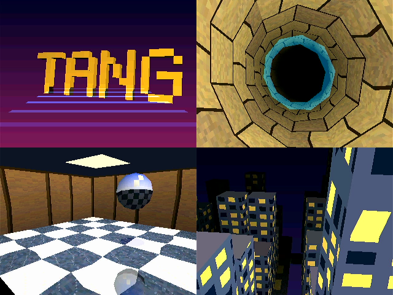

# tang-tiny-gpu

[日本語](README_ja.md)



A small retro-console-style GPU built on the FPGA of a Tang Nano 20K (Gowin GW2AR-18). The intended host CPU is an RP2350.

The FPGA has **two bitstreams**. Both are stored in flash, and the host **switches between them through the `RECONFIG` register** (about 1.7 s).

| Bitstream | What it does | Specification |
| --- | --- | --- |
| **VDP** (loaded at power-on) | 2D: a command GPU that draws into an SDRAM framebuffer (shapes, BLIT, scaling), two tile planes and a window, 128 sprites, Mode 7 and fog, a light map, PCM audio | [docs/SPECIFICATION.md](docs/SPECIFICATION.md) |
| **3D GPU** | 3D: triangles (Gouraud, 16 / 8 / 4bpp textures + CLUT, Z, four semi-transparency modes) drawn with tile-based rendering (TBR). Roughly PS1 class | [docs/SPECIFICATION_3D.md](docs/SPECIFICATION_3D.md) |

Both output a 320 x 240 image as 640 x 480 @ 60Hz HDMI (DVI), and both talk to the host through the same SPI registers and command FIFO.

- All tools are open source (Yosys + yosys-slang, nextpnr-himbaechel, apicula) and run in Docker containers. The host needs only Docker, make,
  and `openFPGALoader` for programming the board
- Every feature is checked by comparing frame CRCs: **reference model (Python) = Verilator = hardware** ([docs/HARNESS.md](docs/HARNESS.md))

The documents under `docs/` are written in Japanese.

## Status

- **VDP**: the command GPU (stages M0–M9), the emulator-oriented tile / sprite engine and Mode 7 (E1–E4, E7), and the 8bpp plane, BLIT4,
  STRETCH_BLIT, light map and audio for running [rs-kessel](https://github.com/fpt/rs-kessel) (K1–K5a) all work on hardware
- **3D GPU**: stages G0–G5. The four scenes above (logo, tunnel, room with a reflective ball, city at night) take 290K–960K clocks per frame on the GPU alone
  (a 60Hz frame is 1,050K), so all of them fit in 60fps. On hardware the link (below) is the bottleneck, giving 30–50fps
- **Bitstream switching**: works with flash multiboot (VDP at 0x000000, 3D GPU at 0x100000) and RECONFIG_N (pin 9). The harness switches to the bitstream it needs
  on its own
- **Host link**: currently the development harness (USB → RP2040-Zero → SPI 8MHz, about 764KB/s). The production link will be the RP2350's HSTX (about 37MB/s expected);
  the board for harness v2 (Pico 2) is being made ([docs/HARNESS2.md](docs/HARNESS2.md)). The production RP2350 firmware (`firmware/`) is still a skeleton
- The stage names (M / E / K / G) are listed in the stage table of [docs/ARCHITECTURE.md](docs/ARCHITECTURE.md)

## Documents

| Kind | Documents |
| --- | --- |
| Specification (for application developers) | [SPECIFICATION.md](docs/SPECIFICATION.md) (VDP), [SPECIFICATION_3D.md](docs/SPECIFICATION_3D.md) (3D GPU) |
| Design | [ARCHITECTURE.md](docs/ARCHITECTURE.md) (internals, lessons from Gowin + open-source tools, stage table, rules for running rs-kessel) |
| Harness and wiring | [HARNESS.md](docs/HARNESS.md) (v1, `harness.py`), [HARNESS2.md](docs/HARNESS2.md) (v2, Pico 2 + HSTX) |
| Process | [DEVELOPMENT_PROCESS.md](docs/DEVELOPMENT_PROCESS.md), [DEVELOPMENT.md](docs/DEVELOPMENT.md) (development environment) |

## Setup

```bash
make images
```

This builds the `docker/fpga` (OSS CAD Suite, about 1GB download) and `docker/pico` (pico-sdk) images one after the other.
Don't build them in parallel: with little memory assigned to Docker Desktop, the build can run out. For networks behind a TLS-intercepting proxy, see [docs/DEVELOPMENT.md](docs/DEVELOPMENT.md).

Only programming the board uses `openFPGALoader` on the host (containers in Docker Desktop on macOS can't see USB).

```bash
brew install openfpgaloader
```

## Usage

```bash
make help
```

### Build and program

| Command | What it does |
| --- | --- |
| `make bitstream` | Builds the VDP (`build/vdp/top.fs`) and the 3D GPU (`build/gpu3d/top.fs`). For one only: `make bitstream-vdp` / `bitstream-gpu3d` |
| `make flash` | Writes both to flash (VDP at 0x000000, 3D GPU at 0x100000). The VDP starts at power-on |
| `make prog` / `make prog-3d` | Loads the VDP / 3D GPU into SRAM (for quick checks; lost at power-off) |
| `make bitstream-lcd` / `make prog-lcd` | A bitstream that shows a test pattern on the 40-pin RGB LCD (800x480). Separate because it shares pins with HDMI |

Before programming, `pincheck-<design>` automatically checks that the FPGA doesn't drive any pin the harness drives.

### Verify

| Command | What it does |
| --- | --- |
| `make lint` | Lints the RTL with Verilator |
| `make sim` / `make sim-tb_<name>` | Testbenches (`sim/tb_*.sv`, Icarus Verilog; `SIM=verilator` also works). VCDs go to `build/sim/` |
| `make scenario SCENARIO=scenarios/…json` | Runs a scenario (a command list) on the whole-system RTL (Verilator) and compares it with the reference model's CRC. `scenarios/gpu3d/` uses the 3D GPU configuration |
| `make render` / `make render-lcd` | Renders the video output to PNG (`build/render/`). `FREEZE=1` gives the reference to compare with the hardware's `FRAME_CRC` |

### Run on hardware (harness)

Connect the harness (an RP2040-Zero bridge, `make harness-fw` / `make harness-deploy`) and drive it with `tools/harness/harness.py` on the host.

| Command | What it does |
| --- | --- |
| `python3 tools/harness/harness.py selftest` | Self-test of wiring, SPI, IRQ, SDRAM and more |
| `python3 tools/harness/harness.py scenario scenarios/…json` | Runs a scenario on hardware and compares it with the reference model's CRC (and the HDMI capture) |
| `make demo` / `make demo SCENE=all` | The 2D demo / the 3D scenes (`logo` `tunnel` `room` `city`; `all` cycles them every 10 s). Switches to the needed bitstream on its own |
| `python3 tools/harness/harness.py reconfig` | Switches between the VDP and the 3D GPU |

Other commands (`fps`, `memtest`, `frametest` and more) are in [docs/HARNESS.md](docs/HARNESS.md).

### Other

| Command | What it does |
| --- | --- |
| `make fw` | RP2350 firmware (`firmware/`, skeleton) |
| `make timing-repro` | Checks nextpnr's Gowin timing analysis (chapter 10 of [docs/ARCHITECTURE.md](docs/ARCHITECTURE.md)) |
| `make shell` / `make shell-pico` | A shell in the container |
| `make zip` | Zips the sources into `dist/<directory name>.zip` |

To view waveforms without installing anything, open `build/sim/*.vcd` in the [browser version of Surfer](https://app.surfer-project.org/).

## Directory layout

```
rtl/
  vdp/          Vendor-neutral RTL: SPI, registers, SDRAM, command GPU (gpu.sv), line compositing, tiles / sprites / Mode 7, audio, TMDS
  gpu3d/        Vendor-neutral RTL: the 3D GPU (raster3d, tri_setup, tri_engine, tile_engine, fb_line)
  gowin/        Parts that use Gowin primitives: top (top.sv; GPU3D selects VDP / 3D GPU), DVI transmitter, LCD version, wiring test
constraints/    Pin constraints (HDMI, LCD, wiring test)
sim/            Testbenches (tb_*.sv), whole-system scenario runner (scenario/), video rendering (verilator/)
scenarios/      Scenarios (command lists and checks). gpu3d/ is for the 3D GPU
tools/harness/  Host tools: harness.py (hardware), gpu_model.py / raster.py (reference model), demo.py / demo3d.py (demos)
harness/        Harness bridge firmware (RP2040 / RP2350), pin table (pins.json), KiCad (v1, v2)
firmware/       Production RP2350 firmware (skeleton)
scripts/        Netlist checks (bsram_check, pincheck, fix_netlist) and more
tools/repro/    Minimal reproductions of tool bugs
docker/         Tool images for the FPGA / RP2350
docs/           Specifications, design, harness, development process
```

## Hardware notes (Tang Nano 20K)

| Signal | Pin |
| --- | --- |
| 27MHz clock | 4 |
| Buttons S1 (reset) / S2 | 88 / 87 |
| LED0–5 (active low) | 15–20 |
| HDMI CLK / D0 / D1 / D2 (P,N) | 33,34 / 35,36 / 37,38 / 39,40 |
| RECONFIG_N (the design drives it low to reconfigure) | 9 (only on TP1 on the board) |

- Device: `GW2AR-LV18QN88C8/I7` (nextpnr family `GW2A-18C`), with 8MiB of in-package SDRAM
- Some 40-pin RGB LCD signals share pins with HDMI, so HDMI and the LCD can't be used at the same time (separate bitstreams)
- The pixel clock is 25.2MHz, slightly off the standard 25.175MHz (most monitors accept it)
- Harness pin assignments are in [docs/HARNESS.md](docs/HARNESS.md) (v1) and [docs/HARNESS2.md](docs/HARNESS2.md) (v2)

## License

[Solderpad Hardware License v2.1](https://solderpad.org/licenses/SHL-2.1/) (Apache License 2.0 extended to cover hardware).
You may instead use it under the Apache License 2.0 (`SPDX-License-Identifier: Apache-2.0 WITH SHL-2.1`). The full text is in [LICENSE.txt](LICENSE.txt).
