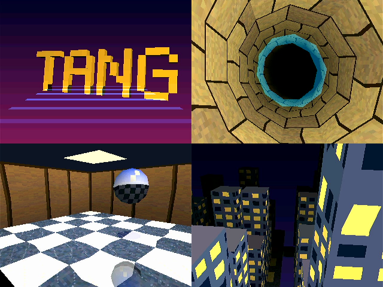

# tang-tiny-gpu

[English](README.md)



Tang Nano 20K (Gowin GW2AR-18) の FPGA で、レトロゲーム機風の小さな GPU を作るプロジェクトです。ホスト CPU は RP2350 を想定しています。

FPGA には **2 つのビットストリーム** があり、フラッシュに一緒に置いて、ホストが **`RECONFIG` レジスタで入れ替えます** (約 1.7 秒)。

| ビットストリーム | 中身 | 仕様 |
| --- | --- | --- |
| **VDP** (電源を入れるとこれ) | 2D: SDRAM のフレームバッファに描くコマンド GPU (図形・BLIT・拡大縮小)、タイルの面 2 枚とウィンドウ、スプライト 128 個、Mode 7 と霧、ライトマップ、PCM の音 | [docs/SPECIFICATION.md](docs/SPECIFICATION.md) |
| **3D GPU** | 3D: 三角形 (Gouraud、テクスチャ 16 / 8 / 4bpp + CLUT、Z、半透明 4 式) をタイルベースの描画 (TBR) で描く。PS1 程度 | [docs/SPECIFICATION_3D.md](docs/SPECIFICATION_3D.md) |

どちらも 320 x 240 の画を 640 x 480 @ 60Hz の HDMI (DVI) に出し、ホストとは同じ SPI のレジスタとコマンド FIFO でつながります。

- ツールはすべてオープンソース (Yosys + yosys-slang、nextpnr-himbaechel、apicula) で、Docker のコンテナの中で動かします。ホストに要るのは Docker と make と、
  ボードへの書き込みの `openFPGALoader` だけです
- 機能はどれも **参照モデル (Python) = Verilator = 実機** のフレームの CRC で確かめています ([docs/HARNESS.md](docs/HARNESS.md))

## 状態

- **VDP**: コマンド GPU (段階 M0〜M9)、エミュレータ向けのタイル / スプライト エンジンと Mode 7 (E1〜E4・E7)、
  [rs-kessel](https://github.com/fpt/rs-kessel) を載せるための 8bpp の面・BLIT4・STRETCH_BLIT・ライトマップ・音 (K1〜K5a) が実機で動いている
- **3D GPU**: 段階 G0〜G5。上の 4 つの場面 (ロゴ、トンネル、映り込む玉の部屋、夜の街) は GPU だけなら
  1 フレーム 290K〜960K クロック (60Hz の 1 フレームは 1,050K) で、どれも 60fps に間に合う。今は実機のリンク (下) が律速で 30〜50fps
- **ビットストリームの切り替え**: フラッシュの multiboot (VDP 0x000000、3D GPU 0x100000) と RECONFIG_N (ピン 9) で動いている。ハーネスは、要るビットストリームが
  動いていなければ自分で切り替える
- **ホストとのリンク**: 今は開発用のハーネスの SPI 8MHz (約 764KB/s)。ハーネス v1 は RP2040-Zero、v2 (Pico 2、[docs/HARNESS2.md](docs/HARNESS2.md)) は
  基板ができて SPI で全部動く (`export HARNESS=v2`)。本番は RP2350 の HSTX (37MB/s の見込み) で、v2 には線があるが、FPGA の受信はまだ。
  RP2350 の本番のファームウェア (`firmware/`) はまだ雛形
- 段階の名前 (M / E / K / G) の意味は [docs/ARCHITECTURE.md](docs/ARCHITECTURE.md) の「段階の記録」

## ドキュメント

| 種類 | 文書 |
| --- | --- |
| 仕様 (アプリケーション開発者向け) | [SPECIFICATION.md](docs/SPECIFICATION.md) (VDP)、[SPECIFICATION_3D.md](docs/SPECIFICATION_3D.md) (3D GPU) |
| 設計 | [ARCHITECTURE.md](docs/ARCHITECTURE.md) (中の作り、Gowin + オープンソースのツールで分かったこと、段階の記録、rs-kessel を載せるときの規則) |
| ハーネスと配線 | [HARNESS.md](docs/HARNESS.md) (v1、`harness.py`)、[HARNESS2.md](docs/HARNESS2.md) (v2、Pico 2 + HSTX) |
| 進め方 | [DEVELOPMENT_PROCESS.md](docs/DEVELOPMENT_PROCESS.md)、[DEVELOPMENT.md](docs/DEVELOPMENT.md) (開発環境) |

## セットアップ

```bash
make images
```

`docker/fpga` (OSS CAD Suite、約 1GB をダウンロード) と `docker/pico` (pico-sdk) のイメージを順番にビルドします。
Docker Desktop の割り当てメモリが少ないとビルドで足りなくなることがあるので、並列にはしないでください。社内プロキシのある環境は [docs/DEVELOPMENT.md](docs/DEVELOPMENT.md)。

ボードへの書き込みだけはホストの `openFPGALoader` を使います (macOS の Docker Desktop のコンテナからは USB が見えないため)。

```bash
brew install openfpgaloader
```

## 使い方

```bash
make help
```

### 作る・書く

| コマンド | 内容 |
| --- | --- |
| `make bitstream` | VDP (`build/vdp/top.fs`) と 3D GPU (`build/gpu3d/top.fs`) を作る。1 つだけなら `make bitstream-vdp` / `bitstream-gpu3d` |
| `make flash` | 2 つをフラッシュに (VDP 0x000000、3D GPU 0x100000)。電源を入れると VDP |
| `make prog` / `make prog-3d` | VDP / 3D GPU を SRAM に (開発中の確かめ。電源を切ると消える) |
| `make bitstream-lcd` / `make prog-lcd` | 40 ピン RGB LCD (800x480) にテストパターンを出すビットストリーム (HDMI とピンを共用するので別)。4.3 インチの 480x272 のパネルには `make bitstream-lcd480` / `make prog-lcd480` |

書く前に、ハーネスが駆動するピンを FPGA が駆動しないかを `pincheck-<設計>` が自動で検査します。

### 確かめる

| コマンド | 内容 |
| --- | --- |
| `make lint` | Verilator で RTL を lint |
| `make sim` / `make sim-tb_<名前>` | テストベンチ (`sim/tb_*.sv`、Icarus Verilog。`SIM=verilator` も)。VCD は `build/sim/` |
| `make scenario SCENARIO=scenarios/…json` | シナリオ (コマンド列) をシステム全体の RTL (Verilator) で走らせ、参照モデルの CRC と比べる。`scenarios/gpu3d/` は 3D GPU の構成 |
| `make render` / `make render-lcd` / `make render-lcd480` | 映像出力を PNG に (`build/render/`)。`FREEZE=1` で実機の `FRAME_CRC` と比べる参照 |

### 実機で動かす (ハーネス)

ハーネス (RP2040-Zero のブリッジ、`make harness-fw` / `make harness-deploy`) をつなぎ、ホストの `tools/harness/harness.py` から操作します。

| コマンド | 内容 |
| --- | --- |
| `python3 tools/harness/harness.py selftest` | 配線・SPI・IRQ・SDRAM などの自己診断 |
| `python3 tools/harness/harness.py scenario scenarios/…json` | シナリオを実機で走らせ、参照モデルの CRC (と HDMI キャプチャ) と比べる |
| `make demo` / `make demo SCENE=all` | 2D のデモ / 3D の場面 (`logo` `tunnel` `room` `city`、`all` で 10 秒ずつ)。要るビットストリームに自分で切り替える |
| `python3 tools/harness/harness.py reconfig` | VDP と 3D GPU を入れ替える |

ほかのコマンド (`fps`、`memtest`、`frametest` など) は [docs/HARNESS.md](docs/HARNESS.md)。

### その他

| コマンド | 内容 |
| --- | --- |
| `make fw` | RP2350 のファームウェア (`firmware/`、雛形) |
| `make timing-repro` | nextpnr の Gowin のタイミング解析の確かめ ([docs/ARCHITECTURE.md](docs/ARCHITECTURE.md) の 10 章) |
| `make shell` / `make shell-pico` | コンテナのシェル |
| `make zip` | ソース一式を `dist/<ディレクトリ名>.zip` に |

波形は [Surfer のブラウザ版](https://app.surfer-project.org/) で `build/sim/*.vcd` を開くと、ホストに何も入れずに見られます。

## ディレクトリ構成

```
rtl/
  vdp/          ベンダ非依存の RTL: SPI、レジスタ、SDRAM、コマンド GPU (gpu.sv)、ライン合成、タイル / スプライト / Mode 7、音、TMDS
  gpu3d/        ベンダ非依存の RTL: 3D GPU (raster3d、tri_setup、tri_engine、tile_engine、fb_line)
  gowin/        Gowin のプリミティブを使う部分: トップ (top.sv。GPU3D で VDP / 3D GPU)、DVI 送信、LCD 版、配線テスト
constraints/    ピン配置 (HDMI、LCD、配線テスト)
sim/            テストベンチ (tb_*.sv)、システム全体のシナリオ実行 (scenario/)、映像の書き出し (verilator/)
scenarios/      シナリオ (コマンド列と check)。gpu3d/ は 3D GPU
tools/harness/  ホストのツール: harness.py (実機)、gpu_model.py / raster.py (参照モデル)、demo.py / demo3d.py (デモ)
harness/        ハーネスのブリッジのファームウェア (RP2040 / RP2350)、配線表 (pins.json)、KiCad (v1、v2)
firmware/       RP2350 の本番のファームウェア (雛形)
scripts/        ネットリストの検査 (bsram_check、pincheck、fix_netlist) など
tools/repro/    ツールの不具合の最小の再現
docker/         FPGA / RP2350 のツールのイメージ
docs/           仕様、設計、ハーネス、開発の進め方
```

## ハードウェアメモ (Tang Nano 20K)

| 信号 | ピン |
| --- | --- |
| 27MHz クロック | 4 |
| ボタン S1 (リセット) / S2 | 88 / 87 |
| LED0〜5 (負論理) | 15〜20 |
| HDMI CLK / D0 / D1 / D2 (P,N) | 33,34 / 35,36 / 37,38 / 39,40 |
| RECONFIG_N (設計が Low にして再コンフィグ) | 9 (基板では TP1 だけ) |

- デバイス: `GW2AR-LV18QN88C8/I7` (nextpnr の family は `GW2A-18C`)。パッケージ内 SDRAM 8MiB
- 40 ピン RGB LCD の信号の一部は HDMI と同じピンなので、HDMI と LCD は同時には使えない (別のビットストリーム)
- ピクセルクロックは 25.2MHz で、規格の 25.175MHz からわずかにずれている (たいていのモニタは表示する)
- ハーネスのピンの割り当ては [docs/HARNESS.md](docs/HARNESS.md) (v1) と [docs/HARNESS2.md](docs/HARNESS2.md) (v2)

## ライセンス

[Solderpad Hardware License v2.1](https://solderpad.org/licenses/SHL-2.1/) (Apache License 2.0 をハードウェア向けに広げたもの)。
選べば Apache License 2.0 としても使えます (`SPDX-License-Identifier: Apache-2.0 WITH SHL-2.1`)。全文は [LICENSE.txt](LICENSE.txt)。
